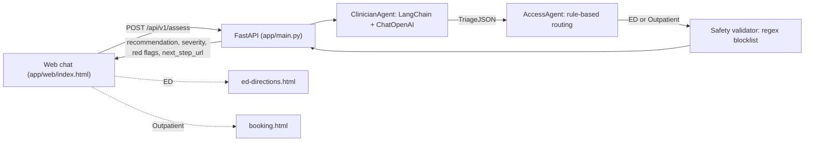

<p align="center">
  
</p>

# AI-Triage: RightCare Medical Triage Assistant

An Arabic-first symptom triage demo. An LLM agent turns free-text symptoms into structured triage JSON, a rules agent routes the patient to the Emergency Department or to outpatient care, and a safety layer checks the final message before it is shown.


**Live demo:** [ai-triage-cyan.vercel.app](https://ai-triage-cyan.vercel.app)

> **Disclaimer:** This is a demo, not a medical device. It does not replace professional medical advice or emergency care.

## Overview

Patients describe their symptoms in Arabic or English in a simple web chat. The FastAPI backend runs a three-stage pipeline:

1. **ClinicianAgent** (LLM + structured output) produces triage JSON.
2. **AccessAgent** (rules on that JSON) makes the final recommendation: **ED** or **Outpatient**.
3. **Safety Layer** (validator) scrubs or overrides unsafe text before the response goes out.

The UI then shows the recommendation, severity, specialty, and red flags, plus a link to the next step (ED directions or appointment booking).

## Features

- **Bilingual chat UI**: switch between English (LTR) and Arabic (RTL). Placeholder text, button labels, and badges are localized.
- **Structured LLM triage**: a LangChain prompt feeds `ChatOpenAI` (temperature 0.2), and a `PydanticOutputParser` validates the reply into a `TriageJSON` object with chief complaint, urgency level, disposition, red flags, specialty, reasoning, Arabic instructions, triage score, and confidence.
- **Deterministic routing**: the AccessAgent sends the patient to the ED if the urgency is `emergent`, the disposition is `ED`, or there is any red flag. Everything else goes to Outpatient.
- **Safety filter**: a regex blocklist in English and Arabic (self-harm, dosing or overdose details, violent threats) replaces unsafe text with a safe fallback message in the user's language.
- **Next-step pages**: a demo ED directions page with an embedded map, and a demo appointment-booking form. The form runs in the browser only and does not send anything to a backend.
- **REST endpoint**: `POST /api/v1/assess`, usable without the UI.
- **Container-ready**: a `Dockerfile` (python:3.11-slim) runs Uvicorn on port 8000.

## How It Works



Example request:

```bash
curl -X POST http://localhost:8000/api/v1/assess \
  -H "Content-Type: application/json" \
  -d '{"symptoms_text": "severe chest pain radiating to left arm", "language": "en"}'
```

The response follows `AssessResponse` in `app/schemas.py`:

```json
{
  "recommendation": "ED | Outpatient",
  "severity": "urgency level from the model",
  "red_flags": ["..."],
  "specialty": "suggested specialty or null",
  "reasoning": "model reasoning",
  "instructions": "localized, safety-checked instructions",
  "next_step_url": "ED directions page or SCHEDULING_URL"
}
```

## Tech Stack

| Layer | Technology |
| --- | --- |
| API | FastAPI, Uvicorn, Pydantic v2, pydantic-settings |
| LLM orchestration | LangChain 0.3 (`langchain-core`, `langchain-openai`) |
| Model | OpenAI chat model via `MODEL_ID` (default `gpt-4o-mini`) |
| Frontend | Static HTML/CSS/JavaScript served by FastAPI |
| Packaging | Docker |

`requirements.txt` also pins `langchain-google-genai` (Gemini), but the current code only uses the OpenAI client.

## Getting Started

**Prerequisites:** Python 3.11 and an OpenAI API key.

```bash
git clone https://github.com/4waiz/AI-Triage.git
cd AI-Triage
python -m venv .venv
source .venv/bin/activate          # Windows: .venv\Scripts\activate
pip install -r requirements.txt
```

Create a `.env` file in the project root (see [Configuration](#configuration)), then start the server:

```bash
uvicorn app.main:app --reload --port 8000
# or, on macOS/Linux:
./run.sh
```

Open <http://localhost:8000> to use the chat UI.

### Docker

```bash
docker build -t ai-triage .
docker run --rm -p 8000:8000 --env-file .env ai-triage
```

### Tests

```bash
pip install pytest
pytest
```

Note: line 14 of `tests/test_endpoints.py` is a stray line (`Tests: tests/test_validator.py`) that raises a `NameError` at import time. Remove it before running the suite. The endpoint test accepts a `500` status when no API key is configured.

## Configuration

`app/config.py` reads these settings from the environment or from `.env`:

| Variable | Default | Purpose |
| --- | --- | --- |
| `OPENAI_API_KEY` | none | Required. Key for the OpenAI chat model. |
| `MODEL_ID` | `gpt-4o-mini` | Chat model used by the ClinicianAgent. |
| `APP_BASE_URL` | `http://localhost:8000` | Base URL used to build the ED directions link. |
| `SCHEDULING_URL` | `https://mychart.example.com/schedule` | `next_step_url` returned for Outpatient results. |
| `ANTHROPIC_API_KEY` | none | Declared in settings but not used yet. |

```env
OPENAI_API_KEY=your-openai-api-key
MODEL_ID=gpt-4o-mini
APP_BASE_URL=http://localhost:8000
SCHEDULING_URL=https://mychart.example.com/schedule
```

Use your own keys and keep `.env` out of version control. The repository has no `.gitignore` yet, so add one that excludes `.env`, `.venv/`, and `__pycache__/`.

## Project Structure

```
AI-Triage/
├── app/
│   ├── main.py                     # FastAPI app: chat UI at "/" and POST /api/v1/assess
│   ├── config.py                   # pydantic-settings configuration (.env)
│   ├── schemas.py                  # AssessRequest, TriageJSON, AccessDecision, AssessResponse
│   ├── agents/
│   │   ├── clinician_agent.py      # LLM -> structured TriageJSON
│   │   └── access_agent.py         # rule-based ED vs Outpatient decision
│   ├── safety/validator.py         # regex blocklist with Arabic/English fallbacks
│   ├── utils/langchain_setup.py    # ChatOpenAI factory (model, temperature, key)
│   ├── protocols/clinical_protocols.json  # ESI levels and protocol reference data (not wired in yet)
│   ├── prompts/                    # placeholder for a grounded ReAct prompt
│   └── web/                        # index.html (chat), ed-directions.html, booking.html, logo.png
├── tests/                          # pytest tests for the endpoint and validator
├── Dockerfile
├── run.sh
└── requirements.txt
```

## License

Released under the [MIT License](LICENSE).

---

Built by [Awaiz Ahmed](https://github.com/4waiz)
